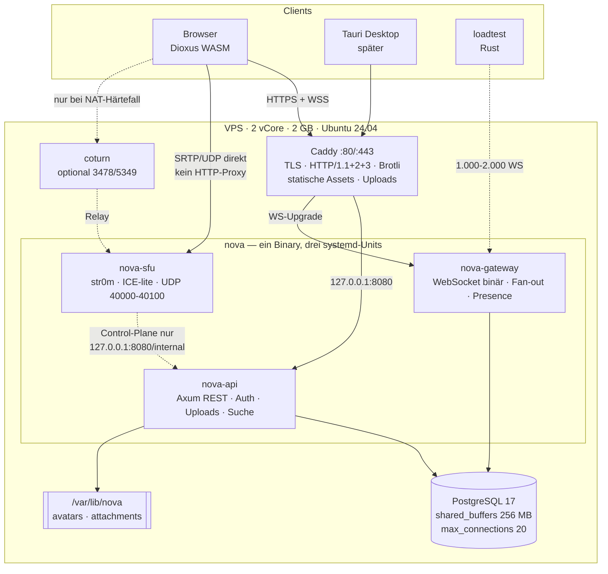
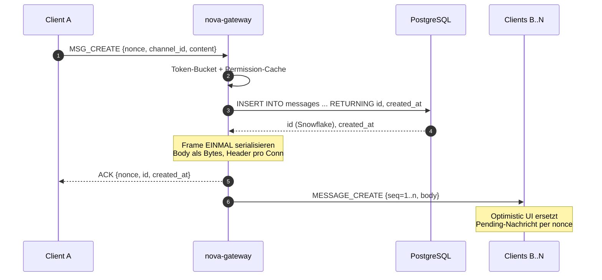
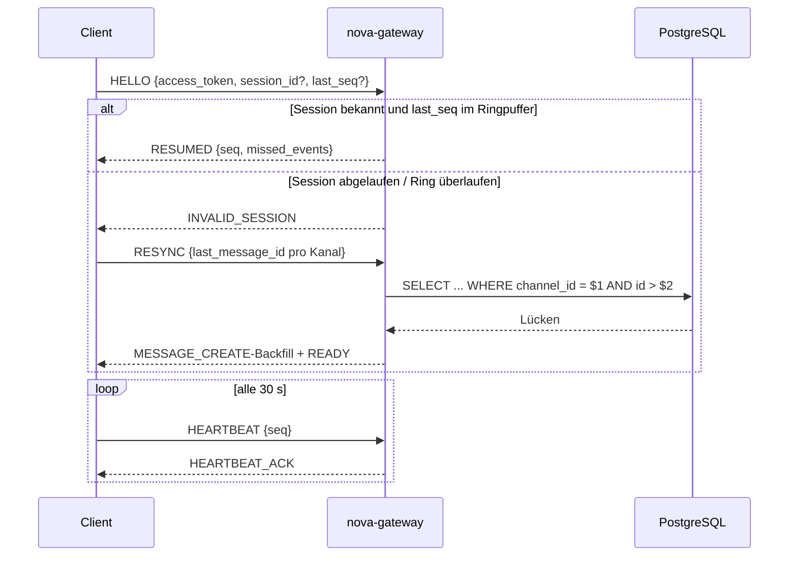
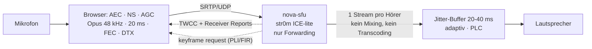
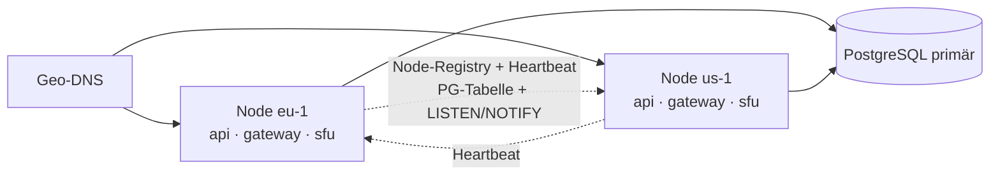

# Project Nova — Architektur (Schritt 1)

**Status:** umgesetzt als **v0.2.0** (Rust-only). Server, Gateway, SFU, Web-UI und Desktop-Shell liegen in einem Cargo-Workspace.
**Zielumgebung:** 1 VPS, 2 vCore, 2 GB RAM, 90 GB NVMe, Ubuntu 24.04 LTS, SSH-Key-Login (live: `85.215.175.202`).
**Sprache im Repo:** Code/Kommentare/Identifier Englisch, Dokumentation und UI-Texte Deutsch (i18n-fähig vorbereitet).

> **Planungsstand vs. Umsetzung:** Die Kapitel zu Caddy, drei systemd-Units und Zero-Downtime beschreiben das ursprüngliche Zielbild. Ausgeliefert wird aktuell **ein Binary** (`nova serve`) hinter Apache/Plesk auf Port 8080, mit PostgreSQL 17, systemd und einer Unit. Abweichungen sind in Kapitel 15.1 dokumentiert.

---

## 1. Ziele und harte Grenzen

Priorität in dieser Reihenfolge: **Voice-Latenz → Performance/Ressourcen → Design/UX → Features → Sicherheit (immer Pflicht)**.

| Größe | Ziel | Harte Grenze |
|---|---|---|
| Gleichzeitige WebSockets | 1.000–2.000 | 2.000 |
| Voice-Teilnehmer gesamt | 20–30 (über mehrere Kanäle) | 30 |
| Voice in **einem** Kanal | 15 (Default-Cap) | 25 (konfigurierbar) |
| Screenshare | **1080p60**, 8–10 Mbit/s, max. 8 Zuschauer | 1 Publisher pro Kanal |
| Mouth-to-Ear lokal | < 100 ms | 150 ms |
| Video-Latenz (Glass-to-Glass) | < 150 ms lokal | 250 ms |
| Text-Nachricht p99 (lokal) | < 50 ms | 150 ms bei Last |
| RSS gesamt (OS+PG+Caddy+App+SFU) | < 1,1 GB | 1,5 GB |
| Frontend Kern-Route | < 200 KB gzip | — |

Nicht verhandelbar: **kein Redis, kein Meilisearch, kein MinIO, kein Prometheus/Grafana, keine Docker-Stacks** auf dem Server. Alles, was diese Dienste leisten würden, wird durch In-Memory-State, PostgreSQL-FTS und das lokale Dateisystem ersetzt.

---

## 2. Entscheidungen im Überblick

| Bereich | Entscheidung | Warum (kurz) | Kosten |
|---|---|---|---|
| HTTP/API | **Axum 0.8 + Tower + Tokio** | Reif, minimale Abstraktion, gute Tower-Middleware, ein Runtime-Modell | ~55 MB RSS Basis, 1–2 Threads |
| WebSocket | **tokio-tungstenite**, binäres Framing; Wechsel auf `fastwebsockets` nur bei Messbefund | Ausgereift, Resume/Upgrade-Handling vorhanden; Hot-Path-Overhead ist syscall-, nicht parserdominiert | ~1–3 % CPU pro 1.000 Conn |
| Serialisierung | **MessagePack** (`rmp-serde`), Envelope-Header handgeschrieben | Kein Codegen-Schritt, schemafrei erweiterbar, ~40 % kleiner als JSON; Protobuf bringt hier < 10 % und kostet Build-Komplexität | ~1 µs/Frame |
| DB | **PostgreSQL 17**, `shared_buffers` 256 MB, `max_connections` 20 | Ein Prozess für Daten, Suche, Queue-Ersatz; kein zweiter Store nötig | ~400 MB RSS |
| Queries | **sqlx mit compile-time-Makros** + committeter `.sqlx`-Offline-Cache | Tippfehler in SQL brechen den Build, nicht die Produktion | Build braucht DB oder Cache |
| State | **DashMap/`papaya`-artige Shards im Prozess** | Presence, Sessions, Rate-Limits, Subscription-Map ohne Netzwerk-Roundtrip | < 20 MB bei 2.000 Conn |
| Auth | **Opaque Access-Token (15 min) im Speicher + rotierende Refresh-Token in PG** | Sofort widerrufbar, keine JWT-Verifikationskosten, kein Schlüssel-Rotationsproblem | 2 Tabellen, ~200 B/Session |
| Passwörter | **Argon2id** (m=19 MiB, t=2, p=1) | Standard, speicherhart; 19 MiB ist auf 2 GB vertretbar | ~40 ms CPU pro Login |
| Voice | **eigener SFU auf `str0m` 0.25 (sans-IO, ICE-lite)** | Kein Async/Lock im Medienpfad, ein Thread pro Kern, exakte Kontrolle über Latenz und Layer-Auswahl | ~110 MB RSS, 1 Kern unter Last |
| SFU-Fallback | **LiveKit selbst gehostet** (Entscheidungstor in M2) | Spart Wochen; kostet Go-Runtime, weniger Kontrolle | ~80–150 MB RSS |
| Frontend | **Dioxus 0.7 (RSX) → Web-WASM**, `dx build`; Assets im Binary | Eine Rust-UI für Web und Desktop, Typprüfung gegen das Protokoll, kein zweiter JS-Toolchain-Stack | ~1,0–1,5 MB gzip WASM+Glue |
| Assets | **rust-embed** im Release, Verzeichnis im Dev | Single-Binary-Anforderung erfüllt | +~2 MB Binary |
| Allocator | **mimalloc** | Weniger Fragmentierung bei vielen kurzlebigen Frames | +~1–3 % Durchsatz |
| Reverse Proxy | **Caddy** (HTTP/3, Brotli, automatisches TLS) | Null Konfigurationsaufwand für TLS/H2/H3, weniger RAM als nginx+Certbot-Gespann | ~40 MB RSS |
| TURN | **coturn, nur aktiviert wenn Messungen es fordern** | Ohne TURN fallen 10–20 % der NAT-Situationen aus; mit TURN kostet es Traffic | ~15 MB RSS |
| Metriken | **`/metrics` (Prometheus-Textformat) nur auf Loopback** | Erfüllt „Messbarkeit“ ohne TSDB-Stack | < 1 MB |
| Deployment | **1 Binary, 3 systemd-Units** (`nova-api`, `nova-gateway`, `nova-sfu`), CI-Build, rsync + Symlink-Tausch | Prozessisolation ohne Container; SFU-Neustart killt keine Chat-Sessions | 0 zusätzliche MB |

### Frontend: Dioxus 0.7 statt SvelteKit

**Gewählt: Dioxus 0.7 (RSX) für Web-WASM und Desktop.** Eine Codebasis in `crates/ui` rendert per `dx build --web --release --features web` nach WASM; `crates/nova` bettet `crates/ui/dist` per `rust-embed` ein. Die Tauri-2-Shell (`desktop/src-tauri`) lädt dieselbe öffentliche URL. WebRTC, Mikrofon und Bildschirmfreigabe laufen direkt über `web-sys`/`wasm-bindgen`; es gibt **kein** Node/npm, kein SvelteKit, kein Tailwind. Handgeschrieben sind nur `assets/app.css` und die HTML-Hülle.

**Kosten der Entscheidung:** WASM+Glue sind größer als eine JS-Shell (Budget in `02-design.md`), und jede Browser-API braucht ein `web-sys`-Binding. Dafür gibt es genau einen UI-Codebaum, Typprüfung zwischen UI und Protokoll und keinen zweiten Toolchain-Stack auf dem Build-Server.

### Warum kein Redis (und was es ersetzt)

| Redis-Aufgabe | Ersatz | Grenze |
|---|---|---|
| Presence | `DashMap<(guild,user), PresenceEntry>` im Gateway | Nur ein Gateway-Prozess → kein Cross-Node-State nötig |
| Pub/Sub zwischen Prozessen | `tokio::sync::broadcast` im Prozess + interner HTTP-Hook API→Gateway | Bei mehreren Nodes später PG `LISTEN/NOTIFY` |
| Rate-Limits | Token-Bucket in `DashMap`, Sweeper-Task alle 60 s | 2.000 Buckets ≈ 200 KB |
| Sessions | Access-Token in `DashMap`, Refresh in PG | Überlebt Gateway-Restart (PG), Access-Tokens nicht (Rebuild nötig) |
| Cache | `moka` (sync, TinyLFU) für Permissions/Guild-Metadaten | 32 MB Cap |

---

## 3. Systemtopologie



**Ports**

| Port | Dienst | Exposition |
|---|---|---|
| 22/tcp | SSH | ufw rate-limited, nur Key-Auth |
| 80, 443/tcp+udp | Caddy | öffentlich (443/udp = HTTP/3) |
| 8080/tcp | nova-api | nur Loopback |
| 8081/tcp | nova-gateway | nur Loopback |
| 40000–40100/udp | nova-sfu | öffentlich, feste Range (ufw + Cloud-Firewall) |
| 3478/5349 | coturn | nur wenn aktiviert |
| 9100/tcp | /metrics | nur Loopback, Scrape per SSH-Tunnel/Cron |

**Wichtig:** Voice-Medien laufen **nie** durch Caddy. Der Signaling-Weg ist Gateway-WS → API-interner Call → SFU-Control (SDP/ICE), Medien gehen direkt per UDP.

---

## 4. Prozess- und Threadmodell

| Unit | Runtime | Threads | Warum |
|---|---|---|---|
| `nova-api` | Tokio Multi-Thread | 2 Worker | HTTP ist I/O-gebunden; 2 Worker reichen, spart Kontextwechsel |
| `nova-gateway` | Tokio Multi-Thread | 2 Worker | 2.000 Conn = 2.000 kleine Tasks; Fan-out ist CPU-leicht |
| `nova-sfu` | **eigene Threads, kein Tokio im Medienpfad** | 2 Worker, je 1 `SO_REUSEPORT`-UDP-Socket | Kein Async-Scheduling-Jitter, keine Locks; Sessions werden per Hash einem Worker zugeordnet |

Der SFU bekommt **keinen** DB-Zugriff. Join/Leave/Permission laufen über einen internen HTTP-Call an `nova-api` (Loopback, `< 1 ms`), bevor der Medienpfad startet. Im Hot Path: nur `HashMap<StreamId, Subscriber>`, `Bytes`-Puffer, SRTP.

---

## 5. Datenfluss: Textnachricht



**Fan-out-Prinzip:** Ein `Arc<[u8]>`-Body, pro Verbindung nur ein 12-Byte-Header (op, seq, len) → `write_all` auf den Socket-Writer-Task. Kein Re-Encode, kein JSON, keine Allokation pro Empfänger außer dem Schreibpuffer.

**Backpressure:** Jede Verbindung hat eine bounded Queue (Kapazität 64 Frames / 128 KB). Verhalten bei Vollstand:

1. Ephemere Frames (TYPING_START, PRESENCE) werden verworfen.
2. Persistente Frames (MESSAGE_*) dürfen die Queue bis 256 Frames füllen.
3. Danach `CLOSE 1013 (Try Again Later)` — der Client resumiert und holt den Backfill aus der DB. **Niemals** unbegrenzt puffern (das ist der klassische OOM bei 2 GB).

---

## 6. Reconnect und Resume



- **Session-Ring:** pro Verbindung 128 Frames / 32 KB, nur im Gateway-RAM. Bei 1.000 Conn ≈ 32 MB worst case, im Schnitt deutlich weniger (die meisten Sessions sind ruhig).
- **Ephemere Events** (Typing, Presence) sind bewusst **nicht** resume-fähig — sie sind nach 2 s wertlos.
- **Persistente Events** (Nachrichten) werden über `last_message_id` aus der DB nachgeladen, nie aus dem Ring. Damit ist Resume auch nach Gateway-Neustart korrekt.
- **Kein Event-Verlust** ist nur für persistente Events garantiert — das ist die ehrliche Zusage.

---

## 7. Voice-Pfad



### Latenz-Budget (Mouth-to-Ear, Ziel 100 ms lokal)

| Abschnitt | Budget | Anmerkung |
|---|---|---|
| Capture + Resampling | 5–10 ms | Browser, 48 kHz nativ |
| Opus-Encode (20 ms Frame) | 15–20 ms | Frame muss gefüllt sein; 10 ms Frames halbieren das, kosten 25 % Bitrate |
| Netzwerk Client→SFU | 5–25 ms | lokal < 5 ms |
| SFU-Transit | < 1 ms | reine Weiterleitung, ein `sendmmsg` |
| Netzwerk SFU→Client | 5–25 ms | |
| Jitter-Buffer | 20–40 ms | adaptiv, Start 30 ms |
| Opus-Decode | 3–8 ms | |
| Playout | 5–10 ms | |
| **Summe** | **58–139 ms** | Ziel lokal < 100 ms, Internet typisch 110–140 ms |

Der Jitter-Buffer ist der einzige bewusst einstellbare Hebel: 20 ms = knacksen bei Netzwerkschwankung, 60 ms = träge. Default 30 ms, adaptiv zwischen 20 und 60 ms.

### Bandbreite pro Teilnehmer (der eigentliche Flaschenhals)

Opus 32 kbps + 20 ms Packetization ergibt 80 B Payload + 12 B RTP + 8 B UDP + 20 B IP = **120 B → 48 kbps auf der Leitung** (1,5× Overhead). DTX senkt das im Schnitt um 25–40 %.

| Szenario | Egress SFU | pro Stunde | pro Monat (4 h/Tag) |
|---|---|---|---|
| 5er-Call (5 Sprecher × 4 Hörer) | 0,96 Mbps | 0,43 GB | 52 GB |
| 15er-Kanal (alle sprechen) | 10,1 Mbps | 4,5 GB | 545 GB |
| 20er-Kanal (alle sprechen) | 18,2 Mbps | 8,2 GB | 984 GB |
| 30er-Kanal (alle sprechen) | 41,8 Mbps | 18,8 GB | 2,26 TB |
| Screenshare 1080p60 @ 8 Mbit/s → 8 Zuschauer | **64 Mbps** | 28,8 GB | 3,46 TB |
| Screenshare 1080p60 @ 10 Mbit/s → 8 Zuschauer | 80 Mbps | 36,0 GB | 4,32 TB |

**Konsequenzen:**

1. Ein 20-TB-Inklusivtraffic reicht für Voice; ein 1-TB-Tarif ist nach ~1 Woche 20er-Kanal am Limit.
2. **Screenshare ist teurer als Voice um Faktor 10.** Deshalb: **1080p60** mit 8–10 Mbit/s und Zuschauer-Cap 8; der SFU wählt pro Zuschauer per TWCC die Simulcast-Stufe (1080p60/720p30). Kein Downscale im Server — ohne Simulcast (z. B. Safari als Streamer) gibt es nur eine Stufe.
3. Default-Kanal-Cap 15 Teilnehmer, 25 nur mit explizitem Opt-in pro Kanal — nicht wegen CPU, sondern wegen Traffic.
4. `pnstats`/Monatszähler in `/metrics`, damit die Traffic-Grenze nicht überrascht.

### CPU-Realität des SFU

30 Sprecher à 50 pps = 1.500 pps Ingress, 30 × 29 = 870 Out-Streams = **43.500 pps Egress**. Bei ~1,5 µs SRTP-Verschlüsselung + Forwarding pro Paket sind das ~65 ms CPU pro Sekunde, plus Syscalls (mit `sendmmsg` gebündelt). Realistisch **25–40 % eines Kerns** für den 30er-Kanal.

**Screenshare 1080p60 (neu):** 8 Mbit/s bei 60 fps und ~1.200-B-Paketen sind ~840 pps pro Zuschauer-Stream, also **6.700 pps für 8 Zuschauer** — weniger Pakete als 30 Sprecher, aber **64–80 Mbit/s Egress**. Video ist damit **bandbreiten-, nicht CPU-gebunden**: SRTP für 6.700 pps kostet ~10 ms CPU/s. Die Gefahr liegt nicht in der Rechenlast, sondern in **Queueing-Latenz für Audio**, wenn Video-Pakete den Sendepuffer füllen. Deshalb (a) Audio-first-Scheduling im Send-Loop, (b) getrennte Sendepuffer/Pacing, (c) DSCP EF für Audio, AF41 für Video, (d) `sendmmsg`-Batching audio-zuerst. Das wird in M2 mit p99-Audio-Inter-Arrival gemessen, nicht behauptet.

---

## 8. Projektstruktur

```
discord clone/                      # Pfad enthält Leerzeichen → Skripte quoten
├── Cargo.toml                      # Workspace, [workspace.dependencies], Release-Profil
├── Cargo.lock                      # committed (Binary-Projekt)
├── rust-toolchain.toml             # 1.89+ (str0m 0.25 MSRV), edition 2024
├── clippy.toml                     # Schwellen, allowed lints
├── rustfmt.toml
├── .cargo/config.toml              # target x86_64-unknown-linux-musl, Aliase
├── .env.example                    # alle Variablen, keine Werte
├── .github/workflows/ci.yml        # fmt · clippy · test · audit · deny · build · size-budget
├── README.md
├── docs/
│   ├── 01-architecture.md          # dieses Dokument
│   ├── 02-design.md                # Designsprache
│   ├── 03-roadmap.md
│   └── benchmarks/                 # m1-gateway.md, m2-voice.md (Messprotokolle)
├── crates/
│   ├── common/                     # Protocol-Typen, Opcodes, Snowflake, Permissions,
│   │   └── src/                    # Config, Fehler, Zeit
│   ├── db/                         # sqlx-Modelle, Repos, migrations/
│   │   └── migrations/
│   ├── api/                        # Axum-Router, Auth, Uploads, Voice-Routen
│   ├── gateway/                    # Sessions, Fan-out, Presence, Resume, Rate-Limits
│   ├── voice-sfu/                  # str0m-Sessions, Rooms, RTP-Routing, TWCC
│   ├── ui/                         # Dioxus-0.7-App (RSX) für Web und Desktop
│   │   ├── src/                    # main, api, gateway, voice, protocol
│   │   ├── assets/app.css          # handgeschriebenes Design
│   │   └── dist/                   # dx-Build, in das Server-Binary eingebettet
│   ├── loadtest/                   # WS- und Voice-Lasttest, Report-Generator
│   └── nova/                       # das Binary: clap-Subcommands, rust-embed, /metrics
├── desktop/src-tauri/               # Tauri-2-Shell, lädt die öffentliche Nova-URL
└── deploy/
    ├── caddy/Caddyfile
    ├── systemd/nova-{api,gateway,sfu}.service
    ├── ufw.sh · fail2ban/ · sysctl.conf
    ├── backup.sh · restore.md
    └── deploy.sh                   # rsync → releases/<ts> → Symlink → restart
```

**Binary-Aufteilung:** `nova` ist ein Binary mit Subcommands (`serve --role api|gateway|sfu`, `migrate`, `hash-password`, `doctor`). Ein Binary = ein Build-Artefakt, drei Units = Isolation und unabhängige Neustarts. `loadtest` ist ein separates Binary, das **nicht** auf dem Produktionsserver läuft.

---

## 9. Gateway-Protokoll

**Frame-Layout (binär, little-endian):**

```
+--------+--------+------------------+---------------------------+
| op: u8 | flags  | seq: u32         | len: u32                  |
+--------+--------+------------------+---------------------------+
| payload: len Bytes (MessagePack)                             |
+--------------------------------------------------------------+
```

- `op`: 0x01 HELLO, 0x02 HELLO_ACK, 0x03 RESUME, 0x04 RESUMED, 0x05 INVALID_SESSION,
  0x06 HEARTBEAT, 0x07 HEARTBEAT_ACK, 0x08 DISPATCH (Server-Event), 0x09 REQUEST,
  0x0A RESPONSE, 0x0B CLOSE.
- `flags`: Bit 0 = komprimiert (Zstd, erst ab Payload > 1 KB — bei typischen Chat-Frames kontraproduktiv), Bit 1 = ephemer.
- `seq`: monoton pro Session, nur für `DISPATCH`; Client bestätigt implizit durch `last_seq` im Resume.
- `len` begrenzt auf 32 KiB (harte Obergrenze); Nachrichten > 8 KiB werden abgelehnt.
- **MessagePack statt Protobuf**: kein Codegen, schemafrei erweiterbar, ~40 % kleiner als JSON. Protobuf wäre ~10 % kleiner, würde aber `prost`-Build + `.proto`-Pflege kosten — bei diesem Team und dieser Frame-Rate kein sinnvoller Trade.

**Presence-Skalierung:** Presence-Änderungen werden pro Guild gebündelt (max. 1 Update/2 s pro User), nicht pro Verbindung gestreut. 1.000 Conn × 1 Update/2 s = 500 Fan-out-Frames/s — unkritisch. Ein „Presence-Sturm“ bei Reconnect wird durch 0–5 s Jitter im Client entzerrt.

**Rate-Limits (Token Bucket, pro Session und pro IP):**

| Aktion | Bucket |
|---|---|
| Nachricht senden | 5 / 5 s, Burst 10 |
| Edit/Delete | 10 / 10 s |
| Reaction | 20 / 10 s |
| Typing | 1 / 3 s (clientseitig gedrosselt, serverseitig verworfen) |
| Voice-Join | 3 / 60 s |
| Login | 5 / min pro IP, 10 / h pro Account |
| Upload | 20 / min |
| Suche | 10 / min |
| Link-Preview | 30 / min (und nur 1 Fetch pro URL/24 h) |

---

## 10. Datenmodell (Auszug)

Snowflake: 41 Bit ms seit Epoch 2025-01-01, 10 Bit Worker, 12 Bit Sequenz — sortierbar, als Cursor nutzbar, `bigint` in PG.

```sql
create table messages (
  id          bigint primary key,
  channel_id  bigint not null references channels(id) on delete cascade,
  author_id   bigint not null references users(id) on delete cascade,
  content     text   not null check (char_length(content) <= 8000),
  reply_to    bigint references messages(id) on delete set null,
  created_at  timestamptz not null default now(),
  edited_at   timestamptz,
  search      tsvector generated always as (to_tsvector('simple', content)) stored
);

-- Cursor-Pagination: kein OFFSET
create index messages_channel_cursor_idx on messages (channel_id, id desc);
create index messages_search_idx on messages using gin (search);
create index messages_author_idx on messages (author_id, id desc);
```

| Tabelle | Zweck | Besonderheit |
|---|---|---|
| `users` | Account, Handle, Avatar, Status | `handle citext unique`, `password_hash`, `totp_secret` nullable |
| `sessions` | Refresh-Token-Familien | `token_hash bytea unique`, `family_id`, `revoked_at`, `user_agent_hash` |
| `guilds`, `guild_members` | Server + Mitgliedschaft | `joined_at` für sortierte Memberliste |
| `roles` | Permissions-Bitfield `bigint` | `position` für Hierarchie |
| `channels` | Text/Voice/Forum/Thread | `parent_id`, `position`, `topic`, `bitrate_cap` |
| `channel_overrides` | allow/deny pro Rolle/User | PK `(channel_id, target_type, target_id)` |
| `messages` | s. o. | `search` als generated column |
| `message_mentions` | `(message_id, user_id)` | Notification-Fan-out ohne JSON-Parsing |
| `reactions` | `(message_id, user_id, emoji)` | PK verhindert Doppel-Reaktion |
| `attachments` | `sha256`, `size`, `mime`, `width/height` | Content-addressed, Dedupe über `sha256` |
| `read_states` | `(user_id, channel_id, last_read_id)` | Ungelesen = `messages.id > last_read_id` |
| `audit_log` | Moderationsaktionen | `bigserial`, append-only |
| `invites` | Code, Ablauf, Uses | `code text unique`, `expires_at` |

**Suche mit Filtern:** `websearch_to_tsquery('simple', $1)` + explizite Prädikate für `von:` (author_id), `in:` (channel_id), `vor:`/`nach:` (created_at), `hat:link` (EXISTS auf attachments). `simple` statt `german/english` vermeidet Sprachmischungs-Fehler; Stemming kann später pro Guild-Sprache nachgezogen werden. Treffer werden auf Kanal-Sichtbarkeit gefiltert (Join auf Permissions), bevor `LIMIT 25` greift.

---

## 11. Auth und Sessions

- **Registrierung:** Handle (3–32, `[a-z0-9_.]`), E-Mail optional in M1 (kein Mailversand nötig → kein SMTP-Dienst), Passwort ≥ 10 Zeichen, Argon2id.
- **Access-Token:** 32 zufällige Bytes (base64url), 15 min TTL, **nur im Client-RAM**, Übertragung als `Authorization: Bearer`. Ablage in `DashMap` → sofortiger Widerruf, keine Signaturprüfung.
- **Refresh-Token:** 32 Bytes, `httpOnly; Secure; SameSite=Lax; Path=/auth`, in PG nur als SHA-256-Hash. **Rotation bei jedem Refresh**, Reuse-Detection → ganze Token-Familie wird widerrufen (Diebstahl-Erkennung).
- **WS-Auth:** Access-Token im ersten `HELLO`-Frame, **nicht** in der URL (Query-Strings landen in Logs und Proxies).
- **CSRF:** API-Mutationen sind Bearer-authentifiziert (nicht cookie-authentifiziert) → kein klassisches CSRF. Der Refresh-Endpoint prüft zusätzlich `Origin`/`Sec-Fetch-Site` und akzeptiert nur den exakten App-Origin.
- **2FA:** TOTP (RFC 6238) optional, Recovery-Codes gehasht. Einbau in M4 (nicht M1), weil es ohne UI keinen Wert hat.
- **Brute-Force:** 5 Fehlversuche/min/IP, 10/h/Account, danach exponentielles Backoff + Fail2ban auf Caddy-Logs.

---

## 12. Uploads und Storage-Abstraktion

```rust
#[async_trait]
pub trait BlobStore: Send + Sync {
    async fn put(&self, key: &BlobKey, data: &[u8]) -> Result<(), StoreError>;
    async fn open(&self, key: &BlobKey) -> Result<BlobReader, StoreError>;
    async fn delete(&self, key: &BlobKey) -> Result<(), StoreError>;
}
```

- Implementierung M1–M3: `LocalFs` unter `/var/lib/nova/uploads/{sha256[0..2]}/{sha256}` (content-addressed → Dedupe, unveränderliche URLs, langes Caching).
- Späterer S3-Tausch ohne API-Änderung; `key` bleibt derselbe.
- **Limits:** Bild 8 MB, Datei 25 MB, Avatar 2 MB; pro Guild 2 GB Default-Quota.
- **Validierung:** `infer` für MIME-Sniffing (nie dem Client-Header trauen), Bilder mit `image` neu kodieren (WebP, max. 1600 px, EXIF strippen) — das entschärft polyglotte Payloads und riesige Pixelbomben. SVG wird **nicht** akzeptiert.
- **Auslieferung:** Caddy `forward_auth` → `/internal/can-view` (prüft Kanalrechte) → `file_server` mit `sendfile`. Damit kostet ein 25-MB-Download ~0 % Rust-CPU statt Streaming durch Axum.
- **90 GB NVMe:** OS+PG+Binary ≈ 8 GB, Backups ≈ 15 GB, Puffer 10 GB → **~55 GB für Uploads**. Bei 25 MB Durchschnitt sind das ~2.200 Dateien. Deshalb: Quota pro Guild, Warnung in `/metrics` bei 70 %, und vor öffentlichem Start entweder S3-Offload oder Upload-Ablauf für Nicht-Premium-Guilds.

---

## 13. RAM-Budget

Schätzungen aus Erfahrungswerten; **jede Zeile wird in M1/M2 durch Messung ersetzt** (`/proc/<pid>/status` VmRSS + `smem`).

| Komponente | Budget | Rechnung / Annahme |
|---|---|---|
| Debian/Ubuntu Basis + journald + sshd | 140 MB | Minimalinstallation, `SystemMaxUse=200M` |
| Caddy | 40 MB | Go-Runtime, 2 Worker |
| PostgreSQL 17 | 400 MB | 256 MB shared_buffers + ~60 MB Katalog + 6 Conn × 8 MB + WAL-Puffer |
| `nova-api` | 90 MB | 40 MB Basis + moka 32 MB + sqlx-Pool + Puffer |
| `nova-gateway` | 150 MB | 35 MB Basis + 1.000 Conn × ~60 KB (TLS 24 KB, Read 8 KB, Write-Queue 16 KB, Session 2 KB, Resume-Ring ~10 KB Ø) + Subscription-Map |
| `nova-sfu` | 110 MB | 25 MB Basis + 30 Sessions × ~250 KB (Rtc + 29 Out-Streams × 6 KB) + Puffer-Pools |
| coturn (optional) | 15 MB | nur wenn aktiviert |
| **Summe** | **945 MB** | von 2.048 MB → **~1,1 GB Reserve** für Page-Cache, Spitzen, `pg_dump` |

**cgroup-Deckel als OOM-Schutz** (keine Kapazitätsplanung): `nova-api` 384 MB, `nova-gateway` 512 MB, `nova-sfu` 384 MB, `postgresql` 700 MB, `caddy` 128 MB. Bei Überschreitung stirbt der eine Prozess kontrolliert, statt den Kernel-OOM-Killer den falschen treffen zu lassen.

**Allocator:** mimalloc, `MIMALLOC_PURGE_DELAY=5000` — verhindert, dass selten genutzte Arenen dauerhaft RSS halten.

---

## 14. PostgreSQL-Tuning

```ini
shared_buffers = 256MB
effective_cache_size = 768MB
work_mem = 4MB
maintenance_work_mem = 64MB
max_connections = 20
wal_buffers = 8MB
max_wal_size = 1GB
min_wal_size = 256MB
checkpoint_timeout = 15min
random_page_cost = 1.1        # NVMe
effective_io_concurrency = 200
synchronous_commit = on       # Nachricht weg > 3 ms gespart
autovacuum_vacuum_scale_factor = 0.05
```

Connection-Pools: api 6, gateway 4, sfu 0. `idle_in_transaction_session_timeout = 10s`, `statement_timeout = 5s` (Analytics/Suche separat 10 s).

---

## 15. Deployment

### 15.1 Rust-only Build-Pipeline und Voraussetzungen

**Lokal (Windows oder Linux):** Rust 1.89+ (Toolchain-Datei), `wasm32-unknown-unknown`, Dioxus-CLI 0.7 (`cargo install dioxus-cli --version 0.7.0`), `pkg-config`/`libssl` nur für optionale Tauri-Builds. **Kein** Node, npm, pnpm oder Bun ist am Build beteiligt.

```bash
# Web-UI (erzeugt crates/ui/dist, wird vom Server eingebettet)
cd crates/ui && dx build --web --release --features web
cp dist/../assets/app.css dist/assets/app.css

# Server + Tests
cargo fmt --all --check
cargo clippy --workspace --all-targets -- -D warnings
cargo clippy -p nova-ui --target wasm32-unknown-unknown --features web -- -D warnings
cargo test --workspace
cargo build --release -p nova
```

**CI:** `.github/workflows/release.yml` baut bei einem Tag `v*` in dieser Reihenfolge: Dioxus-Web-Build → Clippy → Tests → Linux-`x86_64-unknown-linux-musl`-Binary (`.tar.gz`) → Windows-Tauri-Bundles (NSIS `.exe`, MSI) → Linux `.deb` und `.AppImage`. Die Windows-Bundles laufen auf `windows-latest` mit MSVC und WebView2; lokal auf einem GNU-Host ist das MSI nicht reproduzierbar.

**Deployment auf dem VPS:** Apache/Plesk terminiert HTTP auf Port 80 und proxyt auf `127.0.0.1:8080`; systemd-Unit `nova.service` startet `nova serve`. PostgreSQL 17 läuft lokal. UDP 40000–40100 muss in der Provider-Firewall zusätzlich zu 22/80/443 offen sein, sonst bleibt Voice im Browser bei ICE `checking` stehen.

**Build:** GitHub Actions, `x86_64-unknown-linux-musl`, mimalloc → statisches Binary ~18–28 MB (mit eingebettetem Frontend). Kein Kompilieren auf dem VPS. Release-Profil: `opt-level=3`, `lto="fat"`, `codegen-units=1`, `strip=true`, `panic="abort"`. `target-cpu=x86-64-v2` (nicht `native`, sonst crasht das Binary auf anderer VPS-CPU).

**Null-Downtime-Tausch:** `deploy.sh` lädt nach `/opt/nova/releases/<timestamp>/nova`, startet die neue API/Gateway-Instanz auf 8082/8083, wartet auf `/readyz`, schaltet Caddy-Upstream per Admin-API um, SIGTERM an die alte Instanz mit 60 s Drain (WS-Clients erhalten `RECONNECT`, resümieren auf die neue Instanz), Symlink `current` umziehen. **SFU wird nicht mitgetauscht**, solange Calls laufen (separater Deploy-Schritt, Maintenance-Fenster).

**systemd-Härtung (je Unit):**

```ini
User=nova
NoNewPrivileges=yes
ProtectSystem=strict
ProtectHome=yes
PrivateTmp=yes
PrivateDevices=yes
ProtectKernelTunables=yes
ProtectControlGroups=yes
RestrictAddressFamilies=AF_INET AF_INET6 AF_UNIX
RestrictNamespaces=yes
LockPersonality=yes
MemoryDenyWriteExecute=yes
ReadWritePaths=/var/lib/nova
EnvironmentFile=/etc/nova/nova.env
```

**Netz/Host:** ufw default deny incoming, nur 22/80/443 + UDP 40000–40100; Fail2ban für sshd und Caddy-401/403; `unattended-upgrades` nur Security; `sysctl`: `net.core.rmem_max=26214400`, `wmem_max=26214400`, `netdev_max_backlog=16384`; `SO_PRIORITY`/DSCP EF für SFU-Sockets (setzt Provider-Toleranz voraus, wird gemessen, nicht geglaubt).

**Backups:** nächtlich `pg_dump -Fc` + Uploads per `restic` (verschlüsselt, dedupliziert) offsite; Retention 7 daily / 4 weekly / 3 monthly; **Restore-Test monatlich** (ein Backup ohne Restore-Test ist kein Backup). Uploads sind content-addressed → inkrementell billig.

**Logs:** journald mit Cap, `RUST_LOG=info` in Prod, `trace` nur temporär. Keine Tokens/Passwörter/E-Mails in Logs (strukturierter Filter).

---

## 16. Observability und Messmethodik

| Metrik | Typ | Zweck |
|---|---|---|
| `nova_ws_connections` | Gauge | Kapazität |
| `nova_ws_frames_total{dir,op}` | Counter | Fan-out-Volumen |
| `nova_msg_latency_seconds` | Histogram | p50/p95/p99 Text |
| `nova_ws_send_queue_depth` | Histogram | Backpressure-Frühwarnung |
| `nova_sfu_packets_total{kind}` | Counter | Medienlast |
| `nova_sfu_rtt_ms` / `jitter_ms` / `loss_ratio` | Histogram | Qualität pro Session |
| `nova_process_rss_bytes` | Gauge | RAM-Budget |
| `nova_http_requests_total{route,status}` | Counter | Fehlerbild |

**Text-Latenz** wird inline gemessen: Zeitstempel bei Frame-Empfang im Gateway → Zeitstempel nach `write_all` an alle Empfänger (Mikrosekunden, kein Sample-Verlust bei niedriger Rate). **Mouth-to-Ear** wird in M2 mit einem Loopback-Harness gemessen: Client A spielt einen Click-Track, Client B nimmt auf, Kreuzkorrelation im Skript → echte Ende-zu-Ende-Zeit inkl. Jitter-Buffer. Zusätzlich SFU-interne Transit-Zeit (Ingress- minus Egress-Timestamp) als Frühwarnung.

**Lasttest:** `crates/loadtest` — 1.000/2.000 WS-Clients (handshake, heartbeat, 20 msg/s verteilt, Resume-Sturm), 20–30 simulierte Voice-Teilnehmer (str0m als Client, synthetisches Opus). Report: p50/p95/p99, RSS pro Prozess, CPU, verlorene Frames. Läuft **nicht** auf dem Produktions-VPS, sondern von einer zweiten Maschine/CI gegen die öffentliche IP.

---

## 17. Sicherheit (Pflicht, nicht optional)

| Fläche | Maßnahme |
|---|---|
| SQL | ausschließlich Prepared Statements / sqlx-Bindings, keine String-Konkatenation |
| XSS | Markdown-Renderer mit Allowlist, kein `innerHTML` außer durch Sanitizer; CSP `default-src 'self'`, kein `unsafe-eval`; `style-src 'self'` (`app.css`), Theme-Variablen über CSSOM statt Inline-Style |
| CSRF | Bearer-Token-API + Origin-Check am Refresh-Endpoint |
| CORS | nur eigener Origin; `Access-Control-Allow-Credentials` nur für `/auth/*` |
| Uploads | Größen-/MIME-Limits, Re-Encoding, kein SVG, Zufallsnamen, `Content-Disposition: attachment` für Nicht-Bilder, `X-Content-Type-Options: nosniff` |
| SSRF (Link-Preview) | nur `http/https`, DNS-Auflösung + Reject privater/loopback/link-local/metadata-IPs, Redirects manuell max. 3 mit erneuter Prüfung, 1 MB Body-Cap, Timeout 3 s, kein Cookie-Jar |
| Brute-Force | Rate-Limits + Fail2ban + Argon2id |
| Secrets | nur `EnvironmentFile` (`0600`), nie im Repo, `.env` in `.gitignore`, `cargo deny` prüft Lizenz/Advisories |
| Header | HSTS (preload), `X-Frame-Options: DENY`/`frame-ancestors 'none'`, COOP/CORP, `Referrer-Policy: same-origin` |
| CI | `cargo audit`, `cargo deny`, `cargo fmt --check`, `clippy -D warnings`, Tests |
| Tokens | nie in Logs/URLs, Refresh-Rotation mit Reuse-Detection, Session-Liste im UI widerrufbar |

---

## 18. Skalierungspfad (mehrere Nodes, später)



Der Pfad ist bewusst vorbereitet, nicht gebaut: (a) `session_id`/`node_id` im Token, (b) Room→Node-Zuordnung als Tabelle mit Heartbeat, (c) Guild-Events über PG `LISTEN/NOTIFY` statt Prozess-Broadcast. Ein Voice-Room bleibt **immer** auf einem Node (kein Cross-Node-Mixing) — das ist die gleiche Einschränkung, die auch LiveKit hat.

---

## 19. Die ehrliche LiveKit-Alternative

| | Eigener SFU (str0m) | LiveKit selbst gehostet |
|---|---|---|
| Zeit bis „2 Teilnehmer sprechen“ | 3–6 Wochen bis produktionstauglich | 2–3 Tage |
| Kontrolle über Latenz/Jitter-Buffer | vollständig | begrenzt (Config, nicht Code) |
| Simulcast, TWCC, NACK, PLI | selbst bauen (str0m liefert Primitive) | fertig, kampferprobt |
| RAM/CPU | ~110 MB, 1 Kern@30 TN | Go-Binary, ~80–150 MB; Single-Node **ohne** Redis möglich |
| Betrieb | 3 Units, ein Binary, ein Deploy | eigener Dienst + Config + eigene API-Keys, Rolling Updates |
| Risiko | SFU-Bugs treffen nur uns | ausgereift; dafür Abhängigkeit von Go-Ökosystem/Release-Zyklus |
| Skalierung | selbst bauen | Multi-Node via Redis (widerspricht dem „kein Redis“-Ziel) |
| Lizenz | MIT/Apache-2.0 (str0m) | Apache-2.0 |

**Empfehlung:** In M2 zuerst einen **2-Tage-Spike** mit str0m (2 Browser, Audio bidirektional, Latenz gemessen). Ist nach 10 Arbeitstagen kein stabiler 6-Teilnehmer-Call mit < 150 ms erreichbar, wird auf LiveKit gewechselt — der Rest der Architektur (Gateway, Signaling, UI) bleibt unverändert, weil Voice hinter einem `VoiceBackend`-Trait liegt. Diese Entscheidung wird **dokumentiert, nicht improvisiert**.

---

## 20. Was auf 2 vCore/2 GB nicht realistisch ist

1. **Transcoding** (jedes Nicht-Opus-Format, RTMP-Ingest, Aufnahme) — sofort CPU-am-Limit. Nicht bauen. Der SFU bleibt reiner Forwarder: er encodiert **nicht** und kann 1080p60 nicht herunterskalieren — Layer-Auswahl geht nur über die vom Client gesendeten Simulcast-Stufen.
2. **> 25 Teilnehmer in einem Sprachkanal mit Screenshare** — Traffic, nicht CPU. Hard Cap.
3. **Recording/Clips** — 1080p60-Encoding frisst einen ganzen Kern und viel Disk. Nur mit externem Worker.
4. **E2EE + MLS** — Client-CPU okay, aber Key-Distribution und Multi-Device-Sync sind Wochen Arbeit; M5.
5. **Redis/Meilisearch „nur für Komfort“** — jedes zusätzliche Resident-Byte fehlt dem Page-Cache von PG.
6. **1.000 gleichzeitige Screenshare-Zuschauer** — Bandbreite. Nie.
7. **HA/Zero-Downtime bei Hardware-Ausfall** — ein VPS ist ein Single Point of Failure. Voice-Calls sterben bei Reboot. Akzeptiert für MVP, dokumentiert.

---

## 21. Annahmen (bitte korrigieren, wenn falsch)

1. Domain + DNS (A/AAAA) vorhanden; Caddy holt Let's-Encrypt-Zertifikate.
2. Der VPS hat eine öffentliche IPv4 (kein NAT) — sonst ist ICE-Lite nicht nutzbar und TURN wird Pflicht.
3. Server: **IONOS Frankfurt, 1 Gbit/s, unbegrenzter Traffic (Fair Use)**. Die Bandbreiten-Tabelle ist damit eine Fair-Use- und 1-Gbit/s-Grenze, keine Volumengrenze; 74 Mbps Dauerlast sind 7 % des Links, aber 24/7-Betrieb kann Fair-Use-Regeln berühren.
4. Ein Entwickler, Vollzeit, mit Rust-Erfahrung; „Tage“ in der Roadmap sind Personentage.
5. Uploads sind für den Start unkritisch (Community < 500 aktive Nutzer), S3-Offload später.
6. Kein E-Mail-Versand in M1 (keine Registrierungsbestätigung, kein Passwort-Reset per Mail) → Reset per Admin/Recovery-Code. SMTP würde einen weiteren Dienst + Reputation bedeuten.
7. GitHub als CI/Registry ist erlaubt (Repo muss noch angelegt werden).
8. Lokale Entwicklung auf diesem Windows-Rechner: Rust-Toolchain und PostgreSQL müssen installiert werden (beides fehlt aktuell); Builds für den Server laufen in CI.

---

## 22. Offene Punkte für dein OK

1. **Frontend SvelteKit** (statt Leptos/Dioxus) — bestätigen?
2. **SFU: str0m mit 10-Tage-Entscheidungstor, Fallback LiveKit** — bestätigen?
3. **Kanal-Cap 15 (Default) / 25 (Opt-in), Screenshare max. 8 Zuschauer** — bestätigen?
4. **M1-Scope** (siehe Roadmap) — bestätigen oder kürzen?
5. **Kein E-Mail-Versand in M1** — bestätigen?
